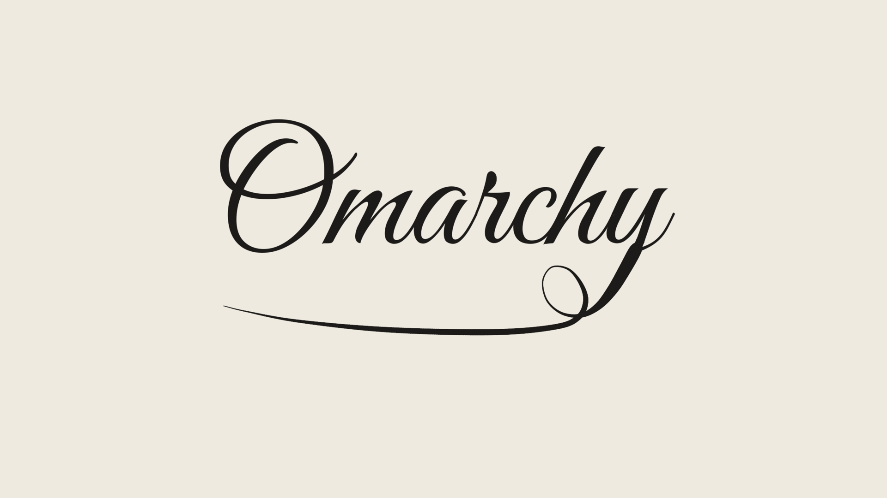

# OmaPaper

An [Omarchy](https://omarchy.org) theme that reads like a good newspaper, with a little Apple calm:
bone-colored paper, warm black ink, graphite rules. Color is saved for meaning: code and terminal
colors are clear printing inks (crimson, vermilion, ochre, bottle green, petrol, cobalt, violet)
dark enough to read comfortably on paper (WCAG 4.5:1+; `tools/check-palette.py`, and
`tools/palette-preview.py` for a visual side-by-side).



## Install

```bash
omarchy theme install https://github.com/wstough/omarchy-omapaper-theme
```

## What's inside

| File | Purpose |
|------|---------|
| `colors.toml` | The palette. Omarchy generates terminal, bar, Hyprland borders, btop, Neovim, VS Code and more from it. |
| `backgrounds/` | Wallpapers (cycle with `omarchy theme bg next`): 20 pieces of art (people, architecture, sky, animals: Dürer, Rembrandt, Goltzius, Piranesi, Rutherfurd, Trouvelot, Muybridge, Audubon, Haeckel) re-printed as halftone, pixel, grain and engraving, plus an "Omarchy" signature. |
| `chromium.theme` | Browser toolbar color (R,G,B). |
| `icons.theme` | GTK icon set name. |
| `unlock.png` | Logo on the lock screen. |
| `preview.png` | Thumbnail in the theme picker. |
| `tools/` | `make-wallpapers.sh` + `wallpapers.list` (art), `make-signature.py` (signature), `check-palette.py`, `palette-preview.py`, `try-shadow.sh`. |

## Recommended window style and fonts

Themes can't change window shape or fonts, so for the intended look add this to
`~/.config/hypr/looknfeel.lua` (rounded corners, hairline border, a soft shadow lit from above):

```lua
hl.config({
  general = { border_size = 1 },
  decoration = {
    rounding = 10,
    shadow = { enabled = true, range = 28, render_power = 2, offset = { -5, 9 },
               color = "rgba(1c1b1933)", color_inactive = "rgba(1c1b1918)" },
  },
})
o.window({ tag = "default-opacity" }, { opacity = "0.995 0.985" })  -- calmer than the default
```

Claude Code: run `/theme` and pick the custom Omarchy theme (or `omarchy-theme-set-claude --activate`)
so it uses these inks instead of its own dark palette.

Try other shadows live with `tools/try-shadow.sh airy|soft|crisp|paper|off`.

Fonts: `omarchy font set "BlexMono Nerd Font"` (IBM Plex Mono; `pacman -S ttf-ibmplex-mono-nerd`),
with Libre Franklin for apps and Newsreader for serif text.

## Credits

Inspired by newspaper design in general. It doesn't use any newspaper's fonts, logos or artwork.
Art wallpapers are re-printed from public-domain/CC0 images on Wikimedia Commons (see
`tools/sources/CREDITS.md`). Fonts are listed there too (all OFL or Apache).

## License

MIT
